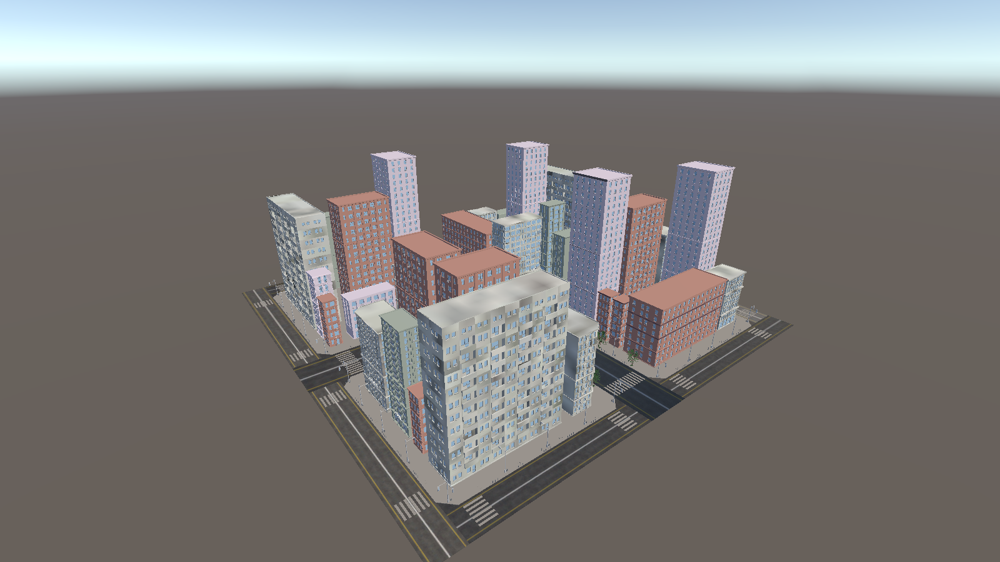
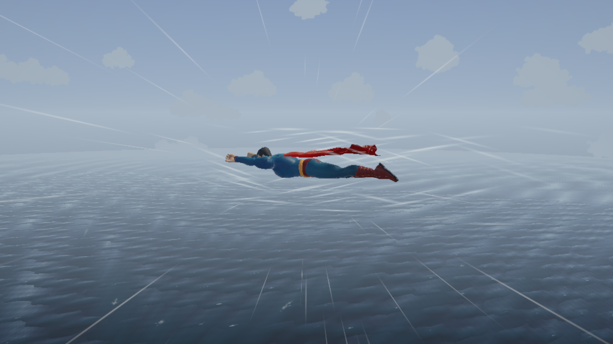
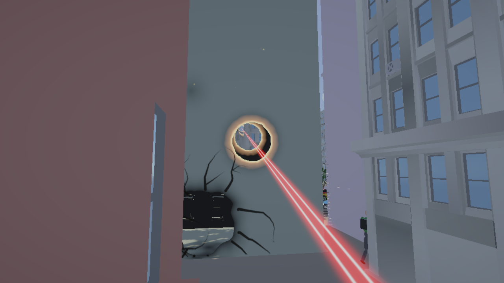
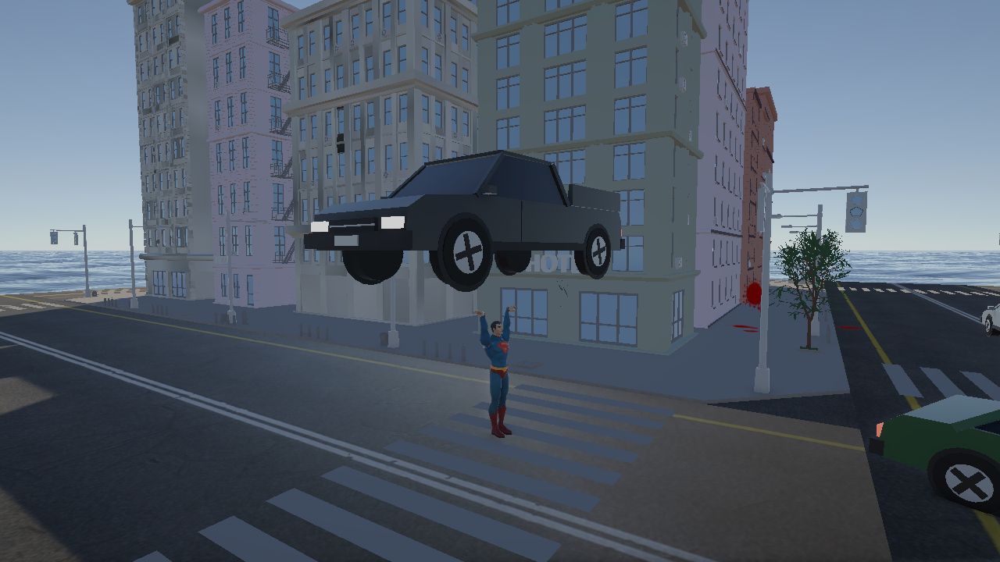
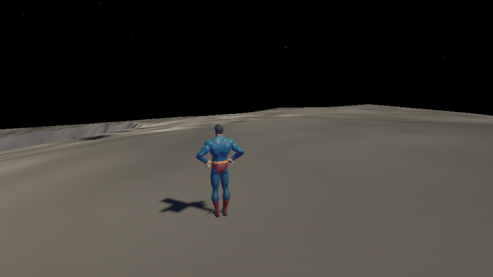
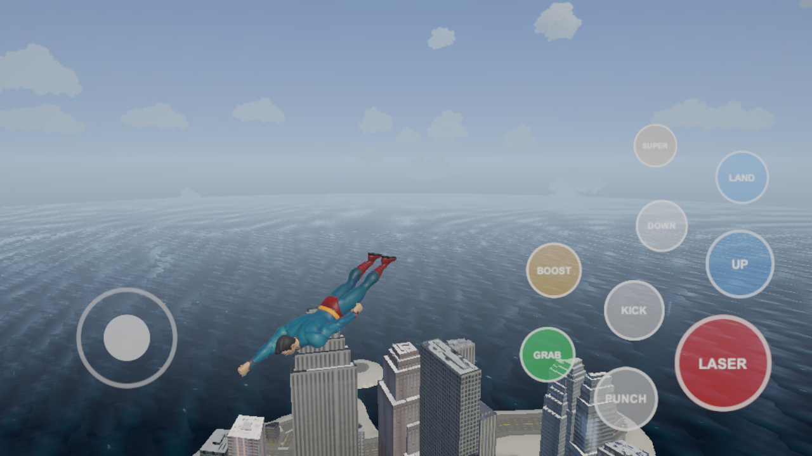

# Skyfall Hero

A third-person superhero sandbox built in Unity 6. Fly over a living city, smash through buildings, burn holes with heat vision, lift cars and planes, and fly straight up through the clouds into space and onto the Moon.

## Features

- **Flight**: take off, hover, boost, and super-speed sprint with afterimages and speed lines
- **Destructible city**: punch, kick, ram or laser holes clean through buildings
- **Heat vision**: a beam that burns, scorches the ground and cuts through cars and planes
- **Super strength**: grab and throw people, cars and even airplanes
- **Living city**: traffic, pedestrians and air traffic that react to you
- **Space**: climb above the clouds, see the Earth, land on the Moon, fight a fighter squadron, then dive back home with re-entry fire
- **Mobile ready**: on-screen touch controls for iOS

## Screenshots

| | |
|---|---|
|  |  |
|  |  |

## Controls

### Keyboard and mouse

Click the Game view to capture the mouse. Press **Esc** to release it.

| Action | Key |
|---|---|
| Move | W A S D |
| Look | Mouse |
| Sprint / flight boost | Left Shift |
| Walk | Left Alt |
| Jump | Space |
| Take off / stop flying | F (or double-tap Space) |
| Fly up / down | Space / Left Ctrl or C |
| Super speed | R |
| Heat vision (hold) / throw held object | Left mouse |
| Punch | Q |
| Kick | E |
| Grab / drop | G |

A gamepad also works.

### Touch (mobile)

On phones, an on-screen joystick and buttons cover the same actions.

## Running it

1. Install **Unity 6000.6.4f1** (Unity 6) through Unity Hub.
2. Clone this repo and open the folder in Unity Hub.
3. Open `Assets/Scenes/City.unity` and press Play.

## Built with

- Unity 6 (URP) and the Input System
- C#: 51 scripts covering the hero, combat, destruction, city life, space and editor tools that build the world
