# Skyfall Hero

A third-person superhero sandbox built in Unity 6. Fly over a living city, smash through buildings, burn holes with heat vision, lift cars and planes, and fly straight up through the clouds into space and onto the Moon.

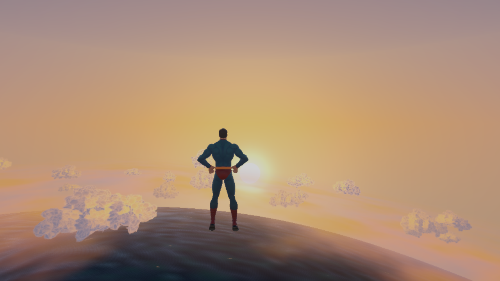

## Features

- **Flight**: take off, hover, boost, and super-speed sprint with afterimages and speed lines
- **Destructible city**: punch, kick, ram or laser holes clean through buildings
- **Heat vision**: a beam that burns, scorches the ground and cuts through cars and planes
- **Super strength**: grab and throw people, cars and even airplanes
- **Living city**: traffic, pedestrians and air traffic that react to you
- **Space**: climb above the clouds, see the Earth, land on the Moon, fight a fighter squadron, then dive back home with re-entry fire
- **Mobile ready**: on-screen touch controls for iOS

## Scenes

### The city

| | |
|---|---|
| 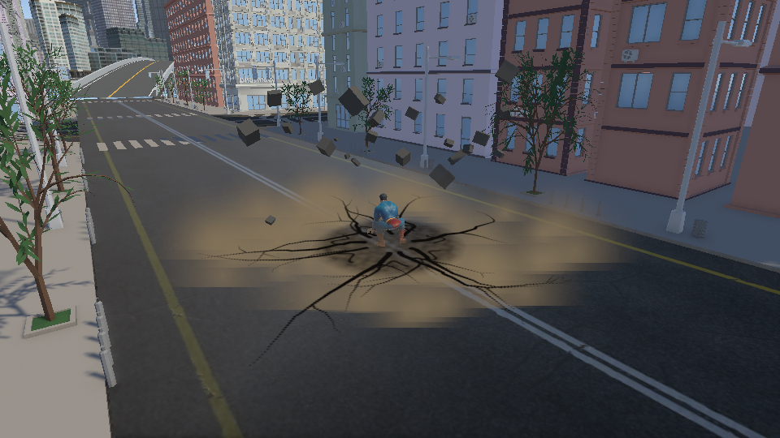 | 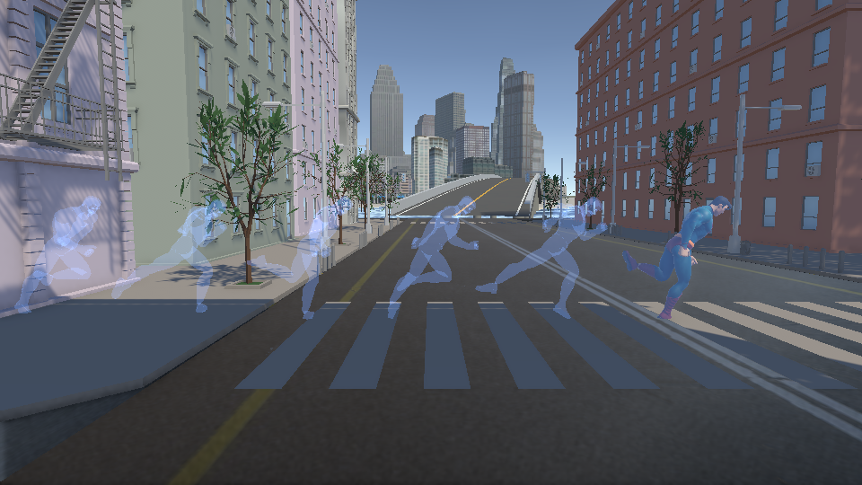 |
| 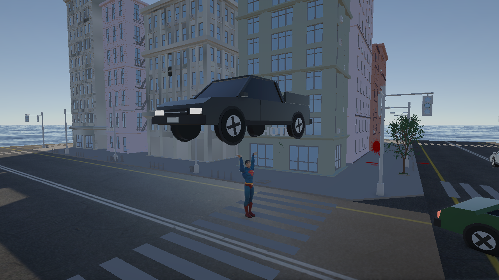 | 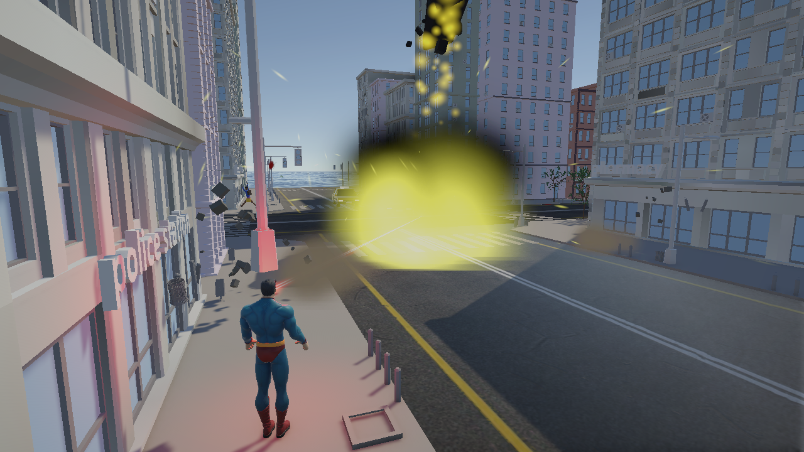 |

### Destruction

| | |
|---|---|
| 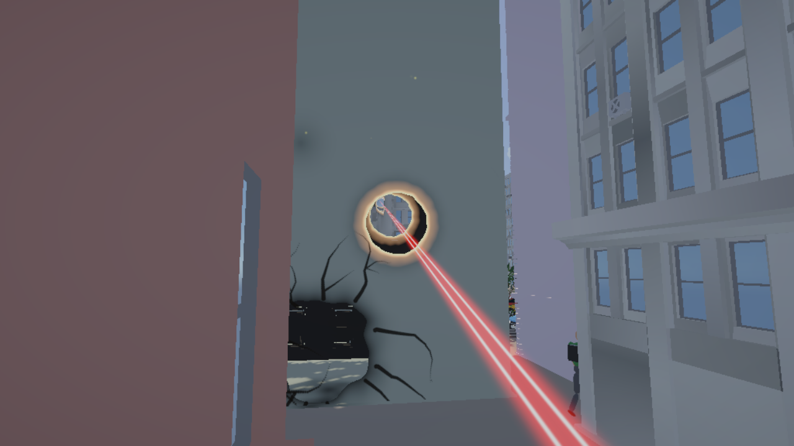 | 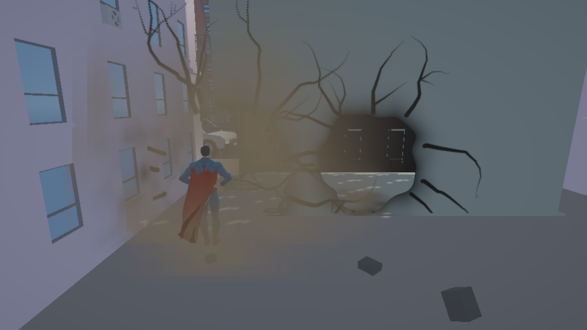 |

### Flight

| | |
|---|---|
| 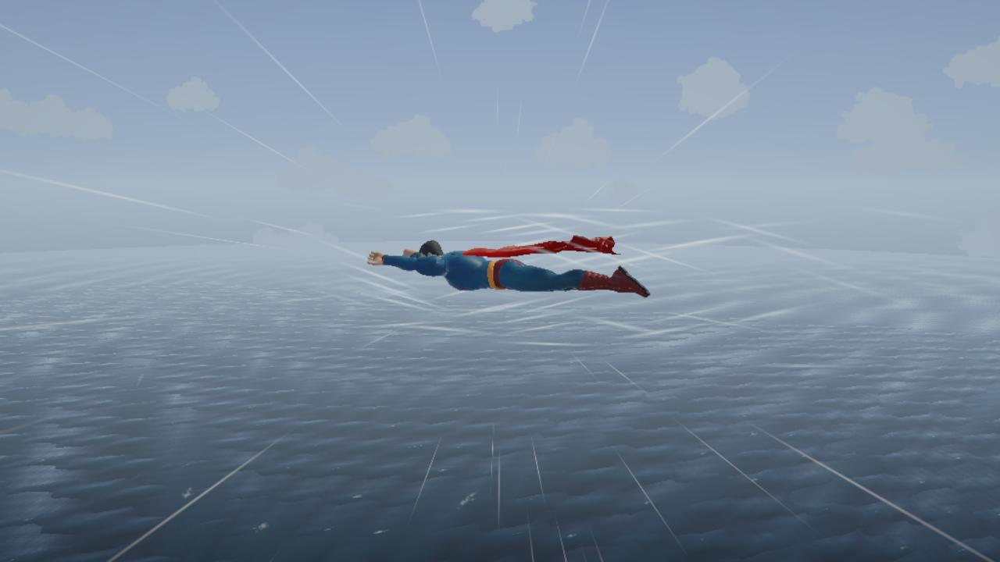 | 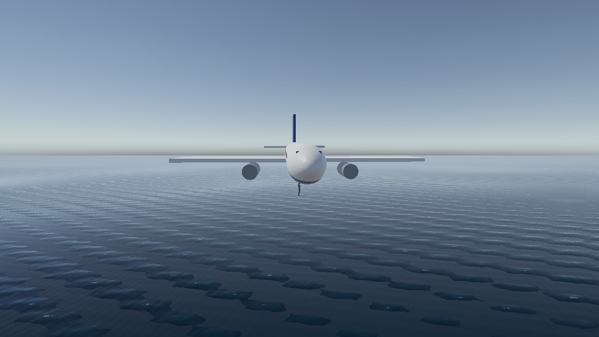 |

### Space

| | |
|---|---|
| 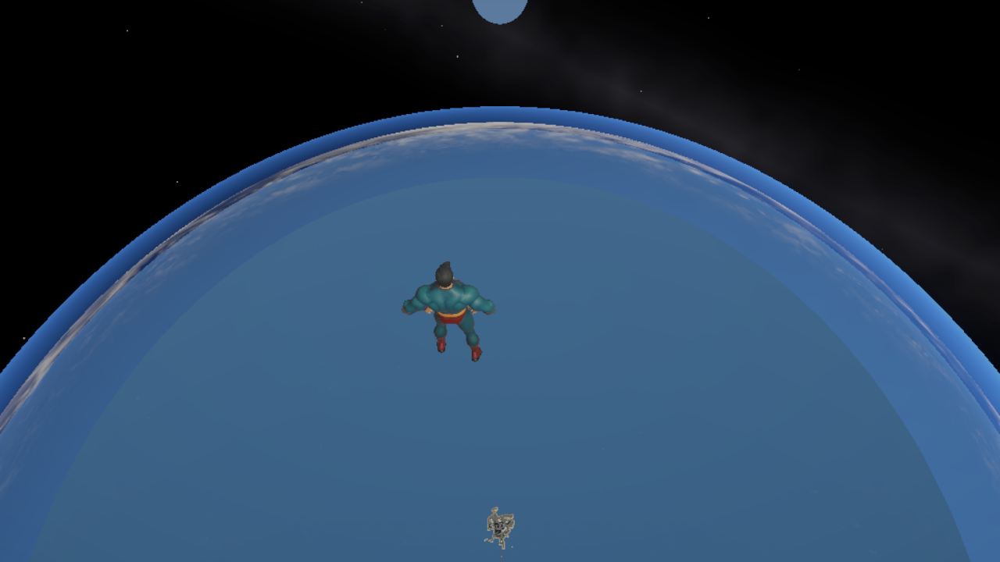 | 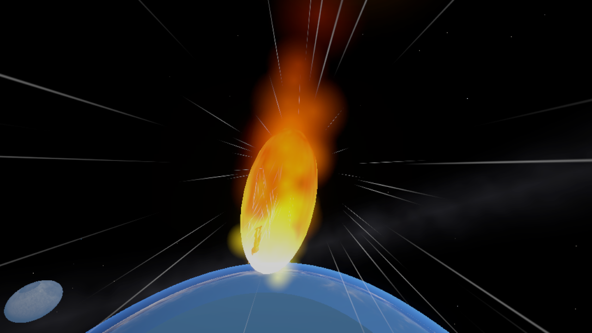 |
| 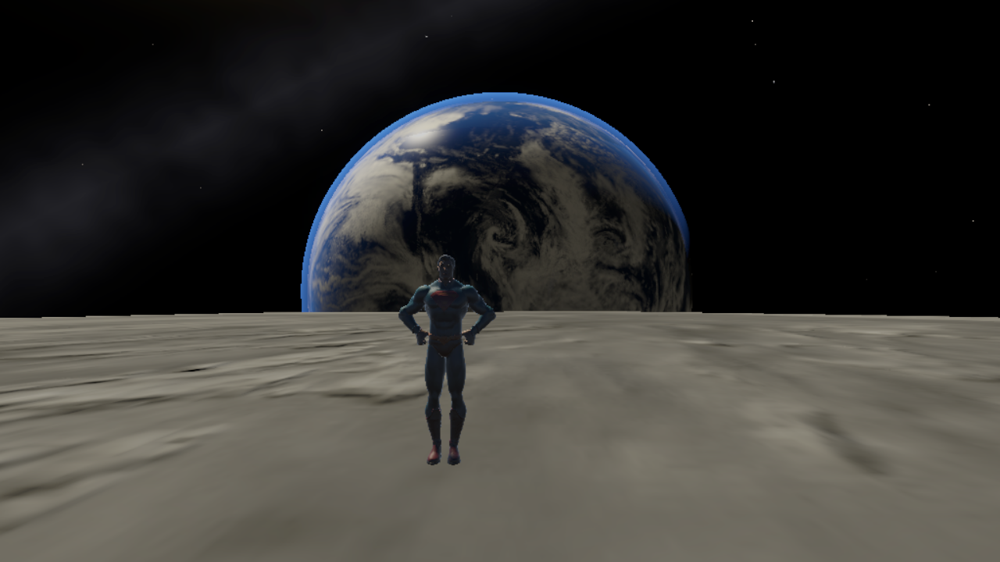 | 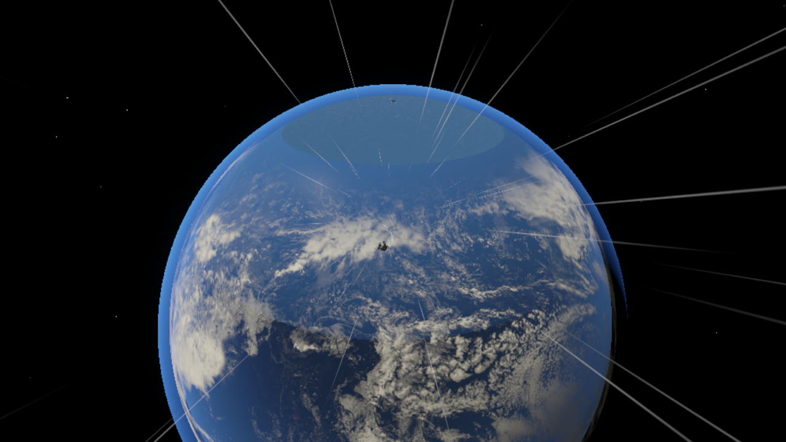 |

## Controls

### Keyboard and mouse

Click the Game view to capture the mouse. Press **Esc** to release it.

| Action | Key |
|---|---|
| Move | W A S D |
| Look | Mouse |
| Sprint / flight boost | Left Shift |
| Walk | Left Alt |
| Jump | Space |
| Take off / stop flying | F (or double-tap Space) |
| Fly up / down | Space / Left Ctrl or C |
| Super speed | R |
| Heat vision (hold) / throw held object | Left mouse |
| Punch | Q |
| Kick | E |
| Grab / drop | G |

A gamepad also works.

### Touch (mobile)

On phones, an on-screen joystick and buttons cover the same actions.

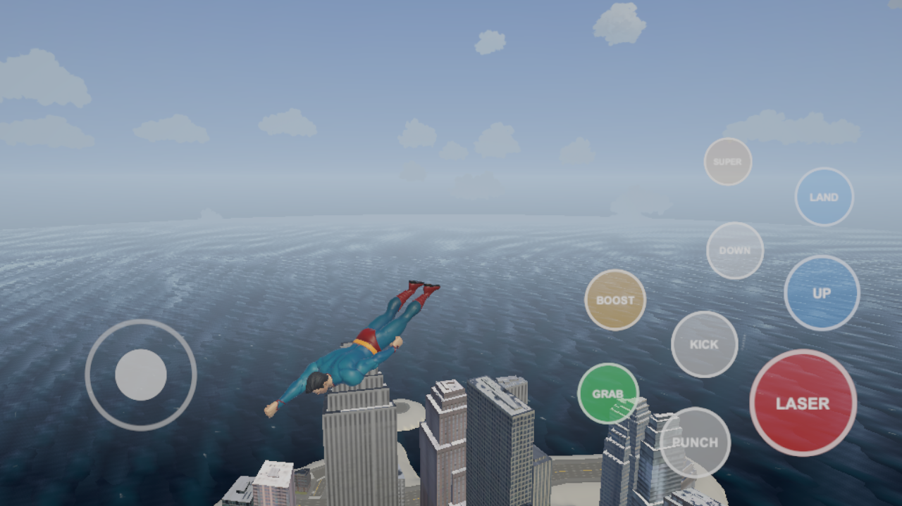

## Running it

1. Install **Unity 6000.6.4f1** (Unity 6) through Unity Hub.
2. Clone this repo and open the folder in Unity Hub.
3. Open `Assets/Scenes/City.unity` and press Play.

## Building for iOS

These steps describe the standard Unity-to-Xcode workflow for testing on an iPhone. **An iOS device build has not been verified for this repository**, so platform-specific issues may still need to be resolved.

### Requirements

- A Mac with Xcode installed, plus an Apple account configured for signing in Xcode.
- **Unity 6000.6.4f1** installed using Unity Hub, with the **iOS Build Support** module added (including its required components).
- A compatible iPhone and a USB connection or a device configured for wireless development. Enable Developer Mode on the iPhone if prompted.

### Export the Unity project

1. Open the repository in Unity Hub with the version listed above.
2. Open `Assets/Scenes/City.unity` and check that it runs in the Unity Editor.
3. Open **File > Build Profiles** and select or add an **iOS** build profile. Install iOS Build Support through Unity Hub if Unity prompts you to do so.
4. Switch the active build target to **iOS**.
5. In the scene list, include `Assets/Scenes/City.unity` as the first enabled scene. The repository's build settings also list `SampleScene.unity`; exclude it if it is not needed for your build.
6. In **Player Settings**, set a unique **Bundle Identifier** (for example, `com.yourname.skyfallhero`) and review the target iOS version and orientation settings.
7. Select **Build**, then choose an output folder outside the Unity project's `Assets` folder. Unity will export an Xcode project.

### Run on an iPhone

1. Open the generated Xcode project or workspace in Xcode.
2. Select the app target and go to **Signing & Capabilities**.
3. Select your Apple development team and confirm the bundle identifier is unique. Xcode may offer automatic signing for personal-device development.
4. Connect and trust your iPhone, select it as the run destination, and enable Developer Mode if requested.
5. Click **Run** in Xcode to build, sign, install, and launch the app on your device.
6. Test touch controls, camera movement, flight, frame rate, memory usage, and scene loading on the physical device.

**Notes:** iOS exports require macOS and Xcode. Signing/provisioning and device compatibility requirements depend on your Apple account, Xcode, and iOS versions. This README documents the workflow; it does not guarantee the current game builds or performs correctly on iOS.

## Built with

- Unity 6 (URP) and the Input System
- C#: 51 scripts covering the hero, combat, destruction, city life, space and editor tools that build the world
